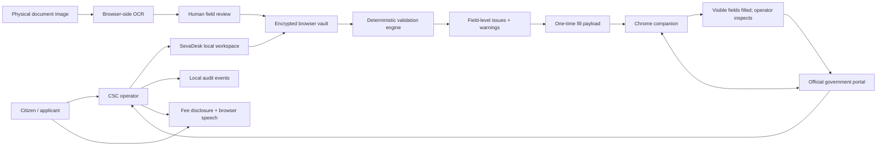
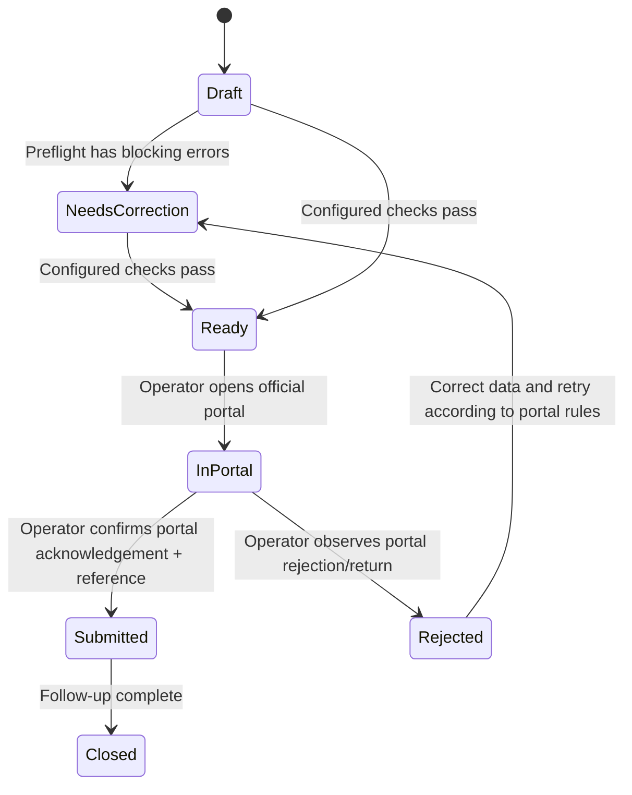

# SevaDesk — architecture and delivery plan

## 1. Product boundary

SevaDesk is a local-first assisted-service workbench for the kiosk operator. It prepares and validates citizen application data, makes fees visible to the citizen, and assists with filling the currently open portal form. It is deliberately **not** a portal aggregator, identity-verification service, scheme-eligibility engine, payment processor or submission proxy.

There is no universal authenticated API that can safely submit every state and central welfare application. Therefore, the first production slice works at the browser level, while actual submission and acknowledgement are performed by the target government portal. Portal-specific integrations must be approved and tested individually.

## 2. System diagram

## 3. Components

### Workspace UI (`index.html`, `styles.css`, `app.js`)

- Responsive operator dashboard; citizen intake; application queue; application review; service/rules configuration; fee display; audit trail.
- Uses actual user-created records only. The empty state begins with zero citizens, applications and service profiles. `vault.js` isolates the Web Crypto encryption and decryption primitives so they can be tested independently.
- Citizen consent must be affirmed before the form can be saved. Deleting a citizen requires typing `DELETE`, removes linked cases from the active vault, and informs the operator that existing audit events/backups are not purged.
- High-risk identifiers are hidden outside the edit form and stored only inside the encrypted vault if an operator explicitly enters them.
- No user-submitted image or OCR text is persisted by the app. It persists only the structured values the operator saves.

### Encrypted local vault

- `localStorage` holds an envelope containing salt, IV and AES-GCM ciphertext, not plaintext case records.
- Passphrase is used to derive an AES-256 key via PBKDF2-SHA-256. The key is held in memory only and cleared on lock.
- Every save encrypts with a fresh random IV.
- Backup export is a copy of the encrypted envelope. It requires the original passphrase to decrypt.
- This is a pragmatic local-first implementation, not a replacement for enterprise key management, central retention enforcement, hardware-backed keys, DLP, workstation hardening or penetration testing.

### OCR (`app.js` + Tesseract.js)

1. Operator selects a local image or camera capture.
2. Tesseract.js and selected language data are loaded from a CDN. OCR processing occurs in the browser.
3. Heuristics emit candidate values; all remain untrusted.
4. Operator selects candidates to copy to form fields.
5. On save, the app stores structured values in encrypted form. It does not store the image or raw OCR output.

When the CDN is unreachable, manual entry remains available. OCR is not available in a fully disconnected fresh install until the engine and language assets are bundled/cached.

### Validation (`core.js`)

- Service-specific required-field list maintained by the operator; local preflight blocks until at least one real required field has been configured.
- Format checks for Indian mobile, six-digit PIN, optional email and IFSC, optional 12-digit Aadhaar, non-future DOB.
- Per-service upload size and extension checks only when those limits have been confirmed and configured; blank limits produce warnings instead of fabricated defaults.
- Fee-source and portal URL warnings.
- The result distinguishes blocking errors from warnings. Passing a local check means only that the configured checks passed; it does not establish eligibility or portal acceptance.

### Rule-based portal-message interpreter

- Recognises common message patterns (file limit, required field, date format, identity field, phone, session timeout, server availability, duplicate record).
- Unknown strings are labelled “unmapped” and never assigned a guessed cause.
- Avoid placing personal details in the error text. The raw error is not saved; only a high-level category may be added to the audit history.

### Browser companion (`browser-extension/`)

- Manifest V3; limited to `activeTab` and `scripting`; no broad host permissions, no background polling, no network calls, no persistent storage.
- Operator pastes the one-time JSON payload, scans visible controls and reviews each field target and value.
- Uses visible labels, names, ids, placeholders, autocomplete, type, HTML pattern and length constraints to propose mappings.
- Passwords, OTP, CAPTCHA, security codes, hidden controls, checkboxes, radios, buttons and file inputs are excluded.
- Fill triggers standard `input` and `change` events to support many frontend frameworks. It skips unmatched select options and unavailable targets.
- It never clicks Submit, uploads documents, authenticates the citizen, bypasses controls or verifies the server response.
- Portal form values are not read during scanning; the page’s field values are not stored by the extension.

### Fee disclosure and audio

- Official/portal fee and operator service charge are separate.
- Official fee is not pre-filled. An operator must enter source URL, check date and amount.
- “Operator verified” is a local declaration, not a live government lookup.
- Citizen mode presents large text; speech uses `speechSynthesis` and installed system voices. Voice/language availability depends on the computer.
- Print output says it is not a government receipt or proof of payment.

## 4. Main data entities

- `OperatorProfile`: operator name, centre name, audio language.
- `Citizen`: selected demographics/contact/identifiers, consent timestamp and purpose, creation/update timestamps.
- `ServiceDefinition`: name, department, verified portal URL, required fields, extensions, max upload size, fee amount, operator charge, source URL, checked date and operator notes.
- `Application`: citizen/service links, status, preflight snapshot, acknowledgement reference, note and timestamps.
- `AuditEvent`: timestamp, action, short description, entity type/id. Avoid raw identity values and OCR text.

## 5. State lifecycle

“Submitted” is a human-attested local state; it is not a server-to-server assertion from SevaDesk.

## 6. Security and privacy controls in this build

- Explicit consent checkbox before storing a citizen record.
- Browser-local processing and encrypted local vault.
- No plaintext citizen records in a hosted database, analytics, or server logs because the app has no backend.
- Mask long identifiers outside editing; file/image and raw OCR output are not persisted.
- Limited extension permissions and ephemeral payload handling.
- Manual OTP/CAPTCHA and submit actions.
- Fee disclosure marks source/configuration gaps, does not create a payment receipt.
- Audit events intentionally avoid field values.

## 7. Risks and hardening required before real centre deployment

1. **Vault lifecycle:** browser storage is tied to a browser profile; there is no central retention enforcement or authenticated multi-operator role model. Enforce OS encryption and device controls; later use a managed local service with an OS-backed key vault or approved central architecture.
2. **Concurrent work / crash recovery:** implement transactional IndexedDB or a backend database with atomic updates, optimistic locking and migration tests.
3. **Portal adapters:** list approved target portals; implement per-portal selectors, date/ID formatting, upload constraints and regression suites against test/staging environments. Version adapters as portal UIs change.
4. **Server truth:** add official, permitted APIs/webhooks for status and receipt verification where available. Do not infer server acceptance from a button click or a visible spinner.
5. **Data governance:** agree lawful purpose, notice/consent wording, retention period, correction and deletion process, incident handling, export rules, operator roles and access logs with the organisation. Review the Digital Personal Data Protection Act/Rules and applicable UIDAI/department restrictions with qualified counsel.
6. **Accessibility and language:** user-test with elderly citizens and low-literacy participants; validate actual Hindi/regional speech voices on target centre devices; add assisted-reading and contrast/keyboard tests.
7. **OCR quality:** create consented, locally held evaluation sets across document condition, glare, handwriting, scripts and low-resolution camera capture; track field-level precision/recall and require human correction for all critical values.
8. **Production assurance:** threat modelling, CSP tightening, dependency pinning/self-hosting OCR assets, XSS review, penetration testing, backup restore drills, audit integrity design, error monitoring without PII, and update policy.

## 8. Recommended implementation roadmap

### Phase A — this runnable foundation

- Local encrypted records; intake; OCR-assisted transcription; deterministic preflight; fee disclosure; local audit; status state machine; generic browser companion.
- Functional unit tests for validation/matching/parsing.

### Phase B — pilot with one approved service

- Choose one real target portal with the department/CSC owner's permission.
- Document every field, accepted value, required document, allowed format/size, fee and rejection message.
- Build a versioned portal adapter with explicit selectors, test fixtures, safe handling of iframe/shadow DOM, visible pre-submit summary, and manual submission.
- Test on a non-production account or sandbox; measure rekeying time, preflight catches, false mappings and application rejection rates.

### Phase C — operational pilot

- Managed devices, operator sign-in/roles, encrypted backup lifecycle, retention controls, disaster recovery, citizen display mode, local languages and support workflow.
- Baseline vs pilot measurement: time per application, first-pass acceptance rate, field-level correction count, repeated visits, fee disputes, OCR correction rate and accessibility comprehension.

### Phase D — production integration

- Only after written authorization and documented API access: official submission/status interfaces, service-specific validation, authoritative fee synchronization, receipts/acknowledgements, department SLA telemetry and administrator reporting.
- Security/privacy assessment, legal review, threat model sign-off and operational support agreement before rollout.

## 9. Acceptance criteria for this deliverable

- Application starts locally in a modern Chromium browser.
- First-run vault is created without seeded citizens or cases.
- Unlock uses a passphrase; incorrect passphrase does not decrypt the vault.
- A consent-confirmed citizen can be created and edited.
- OCR candidate values require operator selection.
- Application can be created from an existing citizen; preflight issues are displayed and recorded.
- Service required fields, fee source/date, amount and upload constraints are editable.
- Citizen fee display, audio attempt and print disclosure work without inventing missing prices.
- “Submitted” cannot be saved without acknowledgement/reference and explicit operator confirmation.
- A citizen can be removed only after typed confirmation; linked application records are removed from the current vault.
- Audit CSV and encrypted backup export/restore are available.
- Extension can scan current page, review mappings and fill allowed fields without clicking Submit.
- Tests pass.
